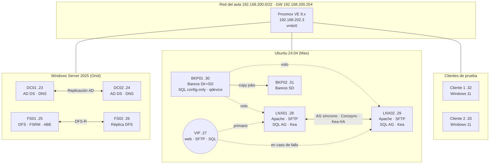

# Documento de diseño de la infraestructura – Fase 1

**Proyecto:** Plan de modernización tecnológica de CiberNova Solutions
**Equipo:** Grupo 3 – Max (Linux) · Oriol (Windows)
**Versión:** 0.7 (borrador) · 19/11/2026 · Los DC no se reenvían entre sí (DC02 promovido) · v0.6 (19/11): Reenviadores corregidos a 8.8.8.8 y 1.1.1.1 · v0.5 (18/11): Datos reales del host, LNX01 en Proxmox, un solo dominio, todas las máquinas en el dominio, configuración del DNS (reenviadores por la intercepción DNS del aula) y GPO de seguridad

> Este documento recoge el análisis de necesidades, las decisiones técnicas con sus alternativas y el diseño de la infraestructura de la Fase 1. Es un documento vivo: cada cambio queda registrado en el historial de Git y, si supone un desfase, en la [bitácora](../gestion/bitacora.md).

---

## Índice

1. [Análisis de necesidades](#1-análisis-de-necesidades)
2. [Enfoque del laboratorio](#2-enfoque-del-laboratorio)
3. [Decisiones tecnológicas](#3-decisiones-tecnológicas)
4. [Arquitectura](#4-arquitectura)
5. [Plan de direccionamiento y nombres](#5-plan-de-direccionamiento-y-nombres)
6. [Inventario de máquinas y dimensionamiento](#6-inventario-de-máquinas-y-dimensionamiento)
7. [Redundancia y análisis de puntos únicos de fallo](#7-redundancia-y-análisis-de-puntos-únicos-de-fallo)
8. [Diseño de identidades (resumen)](#8-diseño-de-identidades-resumen)
9. [Estrategia de copias de seguridad](#9-estrategia-de-copias-de-seguridad)
10. [Arranque y apagado del laboratorio](#10-arranque-y-apagado-del-laboratorio)
11. [Riesgos](#11-riesgos)
12. [Pendientes](#12-pendientes)

---

## 1. Análisis de necesidades

### 1.1 Situación de partida (briefing de Dirección)

- Crecimiento del 300 % en 3 años; 89 empleados en 3 sedes (Barcelona, Madrid, Valencia) y 10 departamentos.
- Servidores físicos aislados, copias manuales y ninguna monitorización.
- Clientes de sectores regulados (sanitario y financiero) que exigen seguridad y disponibilidad para renovar contrato.

### 1.2 Requisitos

| Origen | Requisito | Cómo se cubre |
|---|---|---|
| Dirección | Infraestructura **redundante, sin puntos únicos de fallo** | Todos los servicios en parejas de VMs (apartado 7) |
| Dirección | Toda decisión justificada por escrito | Apartado 3 de este documento y bitácora |
| Dirección | Documentación viva en Git | Repositorio del grupo, conventional commits |
| Enunciado F1 | Identidades, DNS, DHCP, web, FTP/SFTP, BBDD, ficheros con DFS, usuarios/permisos, backups | Apartados 3–9 |
| Anexo I | Alta de usuarios por script idempotente desde CSV, modelo AGDLP, ABE, perfiles, cuotas, auditoría | Apartado 8 e Inventario de servicios, usuarios y grupos |
| Anexo I | `svc_backup` lee toda la estructura sin inicio de sesión interactivo | Apartado 9 |
| Normas del centro | Servidores encendidos solo en horario de proyecto; apagado brusco posible | Apartado 10 |
| Fase 2 (previsión) | La IA trabajará con métricas y logs de la infraestructura | Logs centralizables; IPs .32/.33 reutilizables (apartado 12) |

---

## 2. Enfoque del laboratorio

- **Proxmox VE se usa solo como plataforma de virtualización.** Cada VM se trata como si fuera un servidor físico definitivo de CiberNova.
- **La redundancia se diseña entre parejas de VMs.** En producción, cada miembro de una pareja estaría en un host físico distinto (idealmente, 3 hosts Proxmox en clúster).
- **El único host físico es un riesgo aceptado** y mitigado (RAID 10 por hardware, copias en dos servidores, procedimiento de recuperación). Ver apartado 11.
- **Las VMs se construyen en VirtualBox y se importan en Proxmox como OVA.** Se decidió así después de no poder instalar Windows Server directamente en Proxmox (ver [guía del hipervisor](02-guia-instalacion-hipervisor.md#8-incidencias-durante-la-instalación) y [memoria técnica](03-memoria-tecnica.md#2-método-de-construcción-virtualbox--ova--proxmox)). Permite además avanzar fuera del horario del aula.

---

## 3. Decisiones tecnológicas

Cada decisión indica la opción elegida, las alternativas consideradas y el motivo.

### 3.1 Plataforma de virtualización: **Proxmox VE 9.x**

| Alternativa | Por qué no |
|---|---|
| VMware ESXi | Licencia de pago desde la compra por Broadcom; el centro prioriza software libre |
| XCP-ng | Válida, pero con menos documentación y comunidad en castellano; el equipo ya conoce Proxmox |
| Hyper-V | Requiere licencia de Windows Server en el host; mezcla hipervisor y servicios |

**Motivo:** libre, sin coste de licencias (motivo principal), gestión centralizada desde la interfaz web, posibilidad de crecer en clúster, basado en Debian/KVM, API (útil para el fencing de Pacemaker) y gran comunidad.

Instalación: sistema de archivos ext4 sobre el RAID 10 por hardware (`/dev/sda`), almacenamiento de VMs en `local-lvm` (LVM-thin), repositorios *No-Subscription* configurados con el script *PVE Post Install*. Detalle en la [guía del hipervisor](02-guia-instalacion-hipervisor.md).

### 3.2 Ecosistema: **mixto (Windows + Linux)**

- **Windows Server 2025** para AD DS, DNS y ficheros: el Anexo I está pensado para Active Directory (AGDLP, ABE, perfiles móviles y obligatorios, GPO, FSRM, horarios de inicio de sesión, auditoría de acceso). Hacerlo con Samba AD supondría reproducir a mano funciones que Windows ofrece de forma nativa.
- **Ubuntu Server 24.04 LTS** para web, BBDD, DHCP y backups: libre, ligero, con soporte LTS hasta 2029 y la versión soportada por SQL Server 2025 (desde la CU1). Se eligió frente a Debian por comodidad y familiaridad del equipo.

### 3.3 Identidades y DNS: **Active Directory + DNS integrado**

- Dominio: `cibernova.local` · NetBIOS: `CIBERNOVA`.
- Dos controladores de dominio (DC01, DC02), ambos catálogo global y DNS integrado en AD.
- **Un solo dominio (decidido 17/11/2026).** Alternativa descartada: un dominio por sede o dos dominios. Motivos: el Anexo I pide una única plantilla y una única estructura de carpetas para las tres sedes; la redundancia la dan los **dos DC del mismo dominio**; las sedes se representan con OU y atributos (y, si hiciera falta, Sitios de AD); la frontera de seguridad real de AD es el bosque, así que un segundo dominio añade confianzas, grupos duplicados y 4 DC sin aislar de verdad.
- **Todas las máquinas en el dominio (decidido por Max, 17/11/2026):** DC02 como segundo DC; FS01, FS02 y clientes como miembros; LNX01, LNX02, BKP01 y BKP02 con **realmd + SSSD** (alternativas descartadas: Linux con cuentas locales, por tener dos sistemas de identidades; Samba/winbind, más complejo). En los Linux solo inicia sesión `G_Admin_Sistemas` y se conserva una cuenta local de emergencia; los servicios del clúster no dependen del dominio para arrancar. Host Proxmox: propuesta de no unirlo (dependencia circular) [PENDIENTE DE CONFIRMAR]. Procedimiento: [guía 07](07-guia-dominio-dc02-union.md).
- **Configuración del DNS:** zonas integradas en AD (se replican a DC02), solo actualizaciones seguras, sin transferencias de zona, zona inversa 192.168.202.0/24, reenviadores, registros fijos de los Linux y nombres de servicio hacia la VIP. **Reenviadores 8.8.8.8 (Google) y 1.1.1.1 (Cloudflare)** (18/11/2026; corregido el 18/11 a las 17:35, antes se había anotado 1.1.1.1 y 9.9.9.9): la red del aula intercepta el DNS y no permite la resolución propia desde los servidores raíz, que era la opción preferida. Dos proveedores distintos para tener redundancia. **Los DC no se reenvían entre sí** (19/11): evita bucles y dependencia mutua; los dos tienen las mismas zonas y cada uno sale a Internet por su cuenta. Justificación de cada punto en la [memoria técnica, apartado 3.3](03-memoria-tecnica.md).
- **Nota sobre `.local`:** es un sufijo reservado para mDNS (RFC 6762). Se mantiene por decisión del equipo; para evitar conflictos, en los Ubuntu no se instala `avahi`/`libnss-mdns`. En producción se recomendaría un subdominio de un dominio propio (p. ej. `ad.cibernova.es`).

### 3.4 DHCP: **ISC Kea en HA (hot-standby)**

| Alternativa | Por qué no |
|---|---|
| ISC DHCP (dhcpd) | Fin de mantenimiento desde 2022 |
| DHCP de Windows Server (failover) | Válido, pero el equipo decidió repartir los servicios de red en Linux para equilibrar la carga entre plataformas |

**Particularidad:** la red del aula ya tiene un DHCP. El pool de Kea solo atiende a **clientes conocidos** (reservas por MAC, `client-class: "KNOWN"`) para no repartir direcciones a equipos ajenos. Se coordinará con el profesorado.

### 3.5 Base de datos: **SQL Server 2025 Enterprise Developer – Always On AG**

| Alternativa | Por qué no |
|---|---|
| MariaDB Galera | Válida y libre; se descarta para trabajar con un motor empresarial habitual en clientes del sector financiero y sanitario |
| PostgreSQL + Patroni | Requiere etcd/Consul adicional |
| SQL Server en Windows (WSFC) | Necesitaría 2 VMs Windows más y licencias de evaluación adicionales |

- **Licencia:** Enterprise Developer es gratuita y tiene toda la funcionalidad de Enterprise, pero **solo para desarrollo y pruebas**. Se justifica por tratarse de un laboratorio; en producción CiberNova adquiriría licencias Enterprise.
- **Alta disponibilidad:** Availability Group con commit síncrono entre LNX01 y LNX02, conmutación automática con **Pacemaker + Corosync**, **réplica de solo configuración** (SQL Server Express) en BKP01 como tercer voto, y **fencing con `fence_pve`** contra la API de Proxmox.

### 3.6 Web: **Apache 2.4 (mpm_event + PHP-FPM)**

| Alternativa | Por qué no |
|---|---|
| nginx | Igual de válido; se elige Apache por familiaridad del equipo, soporte de `.htaccess` y módulos maduros |
| Apache con mod_php | Peor rendimiento y aislamiento que PHP-FPM |

- Conexión a SQL Server con el driver ODBC de Microsoft y la extensión `sqlsrv`/`pdo_sqlsrv`.
- Apache es un recurso de Pacemaker (`ocf:heartbeat:apache`): si el servicio falla, se mueve de nodo aunque la máquina siga viva.

### 3.7 FTP/SFTP: **OpenSSH (SFTP con chroot)**

- Se elige SFTP frente a FTP/FTPS porque cifra credenciales y datos con un solo puerto (22) y no necesita software adicional.
- Usuarios enjaulados (`ChrootDirectory`) y limitados a `internal-sftp`.

### 3.8 Ficheros: **Windows Server + DFS-N (dominio) + DFS-R + FSRM**

- Espacio de nombres de dominio `\\cibernova.local\empresa` con destinos en FS01 y FS02.
- DFS-R replica el contenido **y las ACL NTFS** entre los dos servidores.
- **DFS-R no bloquea ficheros abiertos:** para evitar conflictos de edición simultánea, FS01 tiene prioridad en las referencias (todos los clientes trabajan contra FS01; FS02 es la réplica en caliente y toma el relevo si FS01 cae).
- FSRM para cuotas (2 GB / 5 GB / 500 MB con aviso al 90 %); ABE en todos los recursos compartidos.

### 3.9 Alta disponibilidad Linux: **Pacemaker + Corosync**

- Gestiona en un único sitio la VIP, Apache y el AG de SQL Server, con restricciones de colocación (la VIP va siempre con la réplica primaria).
- Se descarta keepalived porque no sabe gestionar el AG de SQL Server; usar ambos duplicaría herramientas.
- Clúster `cibernova-g3`, comunicación unicast (knet) para no interferir con otros grupos del aula. Quórum con qdevice en BKP01.

### 3.10 Copias de seguridad: **Bareos**

| Alternativa | Por qué no |
|---|---|
| Proxmox Backup Server | Depende del hipervisor; el diseño trata cada VM como un servidor físico |
| Borg / restic | Sin gestión centralizada ni agente Windows con VSS |
| UrBackup | Más sencillo pero con menos control de retenciones y copias encadenadas |

**Motivo:** libre, cliente-servidor, agente Windows con **VSS** (copia ficheros abiertos y **conserva ACL NTFS**), retenciones, catálogo y *copy jobs* entre servidores de almacenamiento. Se instala desde el repositorio oficial (la versión debe coincidir en Director, almacenamiento y agentes).

### 3.11 Arquitectura de red: **red plana, sin VLAN (Fase 1)**

Todas las VMs están en la red del aula (192.168.200.0/22), con IPs del rango asignado (192.168.202.23–.33), conectadas al puente `vmbr0` de Proxmox y sin firewall propio entre ellas.

**Requisito:** ningún documento del proyecto (enunciado, presentación y Anexo I) exige VLAN. Se pide un plan de direccionamiento, diagramas de red y una infraestructura sin puntos únicos de fallo. Las VLAN aportan **segmentación** (seguridad), no **redundancia**.

| Alternativa | Por qué no en la Fase 1 |
|---|---|
| VLAN por función (servidores, DMZ web, clientes por sede, copias) con firewall virtual en HA (p. ej. 2× OPNsense con CARP) | Requiere 2 VMs más y redes internas en Proxmox; con el firewall como única salida, este también debe ser redundante. Con 8 máquinas disponibles y 8 sesiones de laboratorio, pondría en riesgo los servicios obligatorios |
| Red interna solo para los clientes de prueba | Necesita un router entre redes (otra VM o funciones de router en los servidores Linux) y complica el DHCP |

**Motivo:** cumple todos los requisitos de la Fase 1, usa las IPs asignadas por el profesorado y concentra el tiempo en los servicios obligatorios y su redundancia.

**Medidas que compensan la falta de segmentación:**
- Firewall de cada servidor: Firewall de Windows (por GPO) y `ufw`/nftables en Ubuntu, abriendo solo los puertos de cada servicio.
- La base de datos solo acepta conexiones de los nodos web y de BKP01.
- Cuentas de servicio con mínimo privilegio y sin inicio de sesión interactivo.

**Mejora prevista para la Fase 3:** la auditoría detectará previsiblemente la red plana como hallazgo ("sin segmentación de red"). Se planifica como **remediación** de la Fase 3: separar en VLAN al menos servidores, DMZ web y clientes, con un firewall redundante, y verificarlo en el re-test. Esto se recoge en la previsión del plan de mejora.

**[PENDIENTE DE CONFIRMAR]:** preguntar al profesorado si espera VLAN en la Fase 1 aunque no figure en los documentos.

---

## 4. Arquitectura



---

## 5. Plan de direccionamiento y nombres

### 5.1 Datos de red

| Parámetro | Valor |
|---|---|
| Red | 192.168.200.0/22 (255.255.252.0) |
| Puerta de enlace | 192.168.200.254 |
| DNS externo (reenviadores de los DC) | 8.8.8.8 y 1.1.1.1 (el DNS del aula, 192.168.200.254, no responde; la red intercepta el DNS) |
| Host Proxmox | 192.168.202.3 |
| Rango asignado a VMs | 192.168.202.23 – 192.168.202.33 |

Todos los servidores y clientes usan como DNS **.23 y .24** (los DC). Solo los DC reenvían hacia fuera (8.8.8.8 y 1.1.1.1).

### 5.2 Asignación

| IP | Nombre (FQDN) | Función |
|---|---|---|
| 192.168.202.23 | dc01.cibernova.local | AD DS, DNS |
| 192.168.202.24 | dc02.cibernova.local | AD DS, DNS |
| 192.168.202.25 | fs01.cibernova.local | Ficheros (DFS, FSRM) |
| 192.168.202.26 | fs02.cibernova.local | Ficheros (réplica DFS) |
| 192.168.202.27 | www / sftp / sqlag.cibernova.local | **VIP** (Pacemaker): web, SFTP, listener del AG |
| 192.168.202.28 | lnx01.cibernova.local | Apache, SFTP, SQL Server, Kea |
| 192.168.202.29 | lnx02.cibernova.local | Apache, SFTP, SQL Server, Kea |
| 192.168.202.30 | bkp01.cibernova.local | Bareos Director + SD, SQL config-only, qdevice |
| 192.168.202.31 | bkp02.cibernova.local | Bareos SD secundario |
| 192.168.202.32 | cli01.cibernova.local | Cliente Windows 11 (reserva DHCP) |
| 192.168.202.33 | cli02.cibernova.local | Cliente Windows 11 (reserva DHCP) |

Los servidores tienen IP estática. Los clientes reciben su IP de Kea mediante reserva por MAC (así se demuestra el servicio DHCP sin interferir con el del aula).

---

## 6. Inventario de máquinas y dimensionamiento

Recursos del host: 2× Xeon E5-2620 v2 (12 núcleos / 24 hilos), 128 GB RAM, 4× 900 GB en RAID 10 por hardware (~1,6 TiB útiles, LVM-thin).

> **[PENDIENTE DE CONFIRMAR]:** los recursos de esta tabla son una propuesta en revisión por Max y Oriol. Las VMs creadas en VirtualBox deben ajustarse a ellos al importarlas.

| VM | SO | vCPU | RAM | Disco SO | Disco datos | Orden de arranque |
|---|---|---|---|---|---|---|
| DC01 | WS 2025 | 2 | 4 GB | 60 GB | — | 1 |
| DC02 | WS 2025 | 2 | 4 GB | 60 GB | — | 1 |
| BKP01 | Ubuntu 24.04 | 2 | 4 GB | 40 GB | 250 GB | 2 |
| BKP02 | Ubuntu 24.04 | 2 | 4 GB | 40 GB | 250 GB | 2 |
| FS01 | WS 2025 | 2 | 6 GB | 60 GB | 150 GB | 3 |
| FS02 | WS 2025 | 2 | 6 GB | 60 GB | 150 GB | 3 |
| LNX01 | Ubuntu 24.04 | 4 | 8 GB | 40 GB | 60 GB | 4 |
| LNX02 | Ubuntu 24.04 | 4 | 8 GB | 40 GB | 60 GB | 4 |
| CLI01 | Windows 11 | 2 | 4 GB | 64 GB | — | 5 |
| CLI02 | Windows 11 | 2 | 4 GB | 64 GB | — | 5 |
| **Total** | | **24** | **52 GB** | | **~1,45 TB asignados** | |

- RAM: quedan ~76 GB libres para el host y para la Fase 2 (IA) y la Fase 3.
- vCPU: 24 asignadas sobre 24 hilos; la carga real es baja, así que la sobreasignación no es problema.
- **LNX01 (17/11):** se instaló con un disco de sistema de **60 GB** en vez de los 40 GB propuestos (57 GB útiles en `/`). Propuesta: dar también 60 GB a LNX02 para que la pareja sea simétrica **[PENDIENTE DE CONFIRMAR]**. Los recursos de la tabla siguen siendo propuestas en revisión.
- Disco: aprovisionamiento fino (thin). Se vigilará el uso real del *thin pool* para que no supere el 80 %.

---

## 7. Redundancia y análisis de puntos únicos de fallo

| Servicio | Mecanismo | Qué pasa si cae un nodo | Prueba de caída |
|---|---|---|---|
| AD DS | 2 DC, replicación multimaestro | El otro DC autentica; los clientes usan el DNS secundario | Apagar DC01 → iniciar sesión en un cliente |
| DNS | Integrado en AD en ambos DC | Los clientes consultan el segundo DNS | `nslookup` con DC01 apagado |
| Ficheros | DFS-N de dominio + DFS-R | Las referencias DFS llevan al cliente a FS02 | Apagar FS01 → abrir `\\cibernova.local\empresa` |
| BBDD | AG síncrono + Pacemaker + config-only en BKP01 | Pacemaker promociona la secundaria y mueve la VIP | Apagar LNX01 → la web sigue consultando la BBDD |
| Web / SFTP | Apache y SFTP en ambos nodos + VIP | La VIP salta al nodo superviviente | Apagar LNX01 → recargar la web |
| DHCP | Kea HA hot-standby | El nodo en espera toma el relevo | Apagar LNX01 → `ipconfig /renew` en un cliente |
| Backups | Dos servidores Bareos con *copy jobs* | Las copias siguen disponibles en BKP02; se promociona su Director (manual) | Restaurar desde BKP02 con BKP01 apagado |

### Puntos únicos de fallo restantes (aceptados y documentados)

| Punto | Mitigación en el laboratorio | Solución en producción |
|---|---|---|
| Host físico único | RAID 10 por hardware, copias en dos servidores, plan de recuperación | 3 hosts Proxmox en clúster con Ceph |
| Conexión de red del host (`vmbr0`) | **Confirmado (17/11): solo `nic0` tiene cable**; las otras tres NIC están libres. Se puede pedir al profesorado un segundo cable para un bond active-backup **[PENDIENTE DE CONFIRMAR]** | Bond en dos switches distintos |
| Switch y puerta de enlace del aula | Fuera de nuestro control | Switches apilados y doble salida |
| Director de Bareos (solo en BKP01) | Director instalado en BKP02 en *cold standby* + copia del catálogo | Director en HA |

---

## 8. Diseño de identidades (resumen)

El detalle (matriz de permisos P-01 a P-44, grupos y script) va en el *Inventario de servicios, usuarios y grupos*. Aquí solo se fija la estructura.

### 8.1 Estructura de OU (creada en DC01)

```
cibernova.local
└── CiberNova
    ├── Usuarios
    │   ├── Direccion        (perfil móvil)
    │   ├── Comercial        (perfil móvil)
    │   ├── Administracion
    │   ├── RRHH
    │   ├── Marketing
    │   ├── Consultoria
    │   ├── Desarrollo
    │   ├── Sistemas
    │   ├── Soporte
    │   └── Legal
    ├── Grupos
    ├── Cuentas especiales
    │   ├── Administracion   (adm.*)
    │   └── Servicios        (svc_*)
    ├── Equipos
    │   ├── Barcelona
    │   ├── Madrid
    │   ├── Valencia
    │   └── Recepcion        (BCN-RECEPCION)
    ├── Servidores
    └── Bajas
```

**Justificación:** las OU por departamento permiten vincular las GPO de perfil (móvil o local con redirección) según el departamento. La sede se gestiona con el atributo `physicalDeliveryOfficeName` y el grupo `G_Sede_*`, no con OU, porque Comercial y Consultoría tienen personal en varias sedes y una OU por sede duplicaría las GPO. Las cuentas especiales van separadas para que no reciban las GPO de los empleados.

**OU Equipos y Servidores (decidido 16/11/2026):** los equipos que se unen al dominio van por defecto al contenedor `Computers`, que no admite GPO. Se crean las OU **Equipos** (una por sede y una para recepción) y **Servidores** para poder vincular GPO de equipo (perfil obligatorio y restricciones de BCN-RECEPCION, perfiles, unidades de red). Los controladores de dominio se quedan en su OU `Domain Controllers`, que es donde se aplica la directiva de controladores de dominio.

### 8.2 Principios

- Modelo **AGDLP**: usuarios → `G_*` (globales) → `DL_<Carpeta>_<Nivel>` (dominio local) → ACL. Los `DL_` se crearán con el servidor de ficheros.
- Los **becarios** no se meten en el grupo de su departamento: van a `G_Becarios` y a `G_Becarios_<Departamento>`, que recibirán solo los permisos reducidos (sin denegaciones).
- Directivas de contraseña: la general con `Set-ADDefaultDomainPasswordPolicy` y la de 15 caracteres con la **PSO `PSO_CiberNova_15`** aplicada al grupo `G_Politica_15` (Dirección, Sistemas y cuentas adm.).
- Alta mediante **scripts PowerShell idempotentes** que leen `usuarios_cibernova.csv` (UTF-8, `;`): [`01-crear-ou-grupos.ps1`](../../scripts/windows/01-crear-ou-grupos.ps1) y [`02-alta-usuarios.ps1`](../../scripts/windows/02-alta-usuarios.ps1).
- Detalle de grupos, miembros y cuentas en el [inventario](05-inventario-servicios-usuarios-grupos.md).

---

## 9. Estrategia de copias de seguridad

### 9.1 Qué se copia

| Origen | Método | Frecuencia |
|---|---|---|
| DC01, DC02 | `wbadmin start systemstatebackup` programado → Bareos recoge el resultado | Diaria |
| FS01 (estructura `empresa`) | Agente Bareos con VSS (conserva ACL NTFS) | Incremental diaria, completa semanal |
| SQL Server | `BACKUP DATABASE` (completa diaria) + `BACKUP LOG` (cada 15 min) desde la réplica secundaria → Bareos | Según tipo |
| LNX01/02, BKP | `/etc`, `/var/www`, configuración de Kea y Pacemaker | Diaria |

### 9.2 Regla 3-2-1

1. Dato original (servidor de origen).
2. Copia en **BKP01** (almacenamiento principal).
3. Copia en **BKP02** (*copy jobs*), que simula la copia en otra sede.

### 9.3 Objetivos

> **[PENDIENTE DE CONFIRMAR]:** objetivos propuestos, en revisión.

| Indicador | Objetivo |
|---|---|
| RPO ficheros | 24 h |
| RPO base de datos | 15 min (copias de log) |
| RTO restauración de una carpeta | < 30 min |
| RTO reconstrucción de un servidor | < 4 h |

### 9.4 Cuenta `svc_backup`

El servicio del agente Bareos en Windows se ejecuta con `svc_backup`, que recibe por GPO el privilegio **"Hacer copias de seguridad de archivos y directorios"** (SeBackupPrivilege) y tiene **denegado el inicio de sesión local y por RDP**. Así lee toda la estructura sin necesidad de permisos NTFS carpeta a carpeta.

---

## 10. Arranque y apagado del laboratorio

Los servidores solo pueden estar encendidos en horario de proyecto y el centro puede apagarlos de forma brusca. Por eso:

- **Orden de arranque en Proxmox** (apartado 6): DC → BKP → FS → LNX → clientes, con retardos entre grupos. Los DC primero porque el resto depende del DNS y de AD; BKP antes que LNX porque aloja el tercer voto del clúster.
- **Apagado ordenado al final de cada sesión**, en orden inverso (lo hace Proxmox al apagar el host).
- Los clústeres deben recuperarse solos después de un apagado completo: se comprobará en las pruebas.

---

## 11. Riesgos

| Riesgo | Probabilidad | Impacto | Mitigación |
|---|---|---|---|
| Poco tiempo de laboratorio: 6 sesiones de 2 h hasta el cierre de GitHub del 4/12 (D-04) | Alta | Alto | Trabajo preparado en casa (scripts, configuraciones, documentación); plan B para el AG |
| Complejidad del AG de SQL Server en Linux con Pacemaker | Media | Alto | Semana dedicada; si no funciona el 1/12, plan B: AG con conmutación manual y documentar el desfase |
| Caducidad de la evaluación de Windows Server 2025 (180 días, ~mayo) | Alta | Alto | Comprobar *rearm* con `slmgr /dlv`; registrar fecha de caducidad |
| DHCP del aula responde a nuestros clientes | Media | Medio | Pool solo para clientes conocidos; coordinar con el profesorado |
| Conflictos con otros grupos en la red compartida | Baja | Medio | Identificadores propios y unicast |
| Red plana sin segmentación: un equipo comprometido llega a todos los servidores | Media | Alto | Firewall en cada servidor y mínimo privilegio; segmentación con VLAN prevista como remediación en la Fase 3 (apartado 3.11) |
| Apagado brusco de los servidores | Media | Medio | Orden de arranque, apagado ordenado, copias |
| Fallo del host físico | Baja | Muy alto | RAID 10, copias en dos servidores, plan de recuperación |
| Problemas al importar OVA de VirtualBox (disco o red no reconocidos, IP perdida) | **Ocurrido** (17/11, LNX01: el asistente no lee la OVA) | Medio | Importación manual (`tar` + `qm create` + `qm importdisk`); Windows con disco SATA y red E1000 hasta instalar VirtIO; reconfigurar la IP |
| **Cierre del repositorio el 4/12/2026** (11 días antes del fin de la fase) | Cierta | Alto | Calendario replanificado (D-04): servicios y pruebas en las sesiones 2–6; subida final el 4/12 |
| Poco espacio en `local` (~24 GB libres) para las OVA | Media | Bajo | Subir y borrar las OVA de una en una |
| **El DNS del aula (192.168.200.254) no responde** a las VMs del rango .23–.33 (comprobado el 17/11), aunque sí hay salida a Internet | **Ocurrido** | Medio | Linux con DNS públicos (8.8.8.8, 1.1.1.1) mientras no estén los DC; después, clientes y servidores → .23/.24 y reenviadores de los DC → **8.8.8.8 y 1.1.1.1** (decidido el 18/11: además, la red del aula **intercepta el DNS**, así que los DC no pueden resolver solos desde los servidores raíz) |
| Clones de VM con identificadores repetidos (`machine-id`, claves SSH, IP) | Media | Alto | Personalizar cada clon antes de conectarlo con el original encendido (memoria técnica 2.3.5) |
| DC duplicado o restaurado desde una copia antigua tras la importación | Baja | Muy alto | Importar cada DC una sola vez y apagar definitivamente la copia de VirtualBox |

---

## 12. Pendientes

> La lista completa de tareas y su estado está en [`docs/gestion/lista-tareas-fase1.md`](../gestion/lista-tareas-fase1.md).

- [x] Host confirmado (17/11): RAID 10 por hardware, LVM-thin, una sola NIC con cable, `vmbr0` /22, Proxmox 9.2.21.
- [x] ~~La VM Ubuntu "WEB01" (192.168.202.25) se adapta a LNX01 (.28)~~ (16/11). **Anulado el 17/11:** WEB01 no era Ubuntu 24.04; LNX01 se instaló de cero en VirtualBox y se importa como OVA (desfase D-03). La .25 queda para FS01.
- [x] LNX02 y BKP01 creadas el 17/11 clonando LNX01 en Proxmox (opción A, con `machine-id`, claves SSH, nombre e IP propios). BKP02: también como clon [PENDIENTE DE CONFIRMAR].
- [ ] Decidir la aplicación web (debe usar SQL Server).
- [ ] Hablar con el profesorado del DHCP en la red del aula y de una segunda NIC.
- [ ] Fase 2: la IA necesitará al menos una IP; se reutilizarán .32/.33 o se pedirán más.
- [ ] Preguntar al profesorado si se esperan VLAN en la Fase 1 (apartado 3.11).
- [ ] Fase 3: segmentación de red con VLAN y firewall redundante como remediación.
- [ ] Diagramas de red y de arquitectura en `docs/diagramas` (Mermaid), exigidos en el entregable.
- [ ] Decidir el uso de `svc_web` y `svc_bbdd` en los servicios Linux (mínimo privilegio).
- [ ] Decidir cómo se mantiene igual el contenido web y los datos del SFTP en LNX01 y LNX02.
- [ ] Copia de las VMs (norma 2 del enunciado): propuesta `vzdump` [PENDIENTE DE CONFIRMAR].
